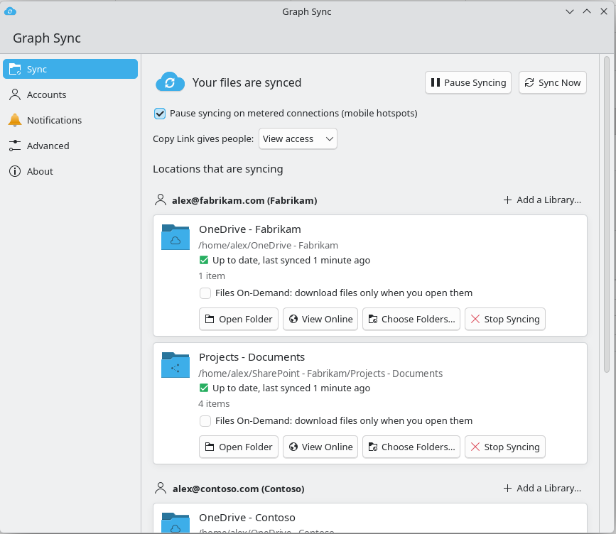
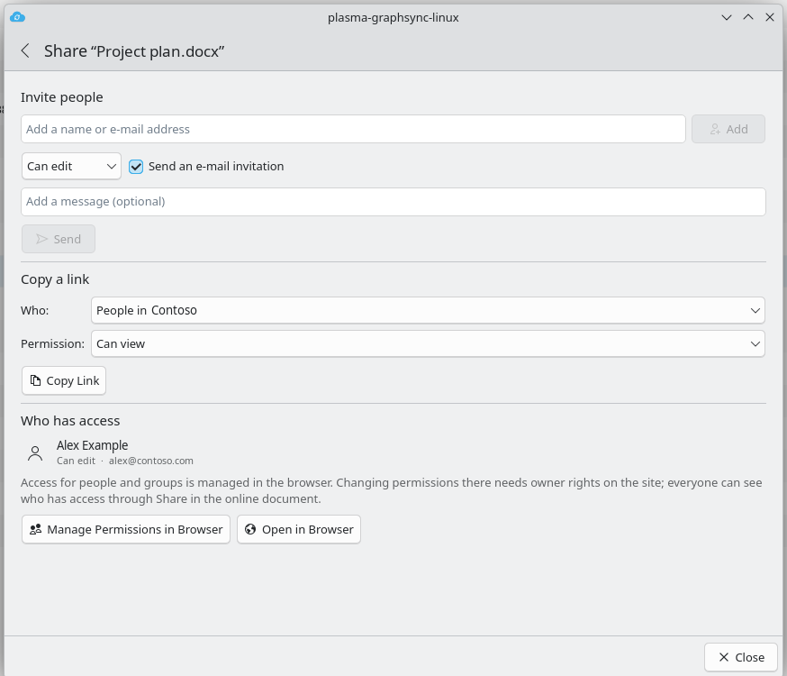
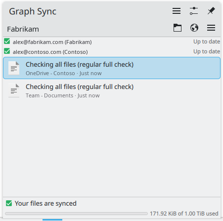
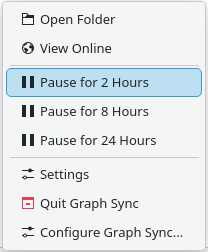

# Graph Sync

**Sync client for Microsoft OneDrive and SharePoint on KDE Plasma** (package and repository:
`plasma-graphsync-linux`).

A native KDE Plasma 6 sync client for OneDrive for Business and SharePoint document
libraries, written in C++ with Qt 6 and KDE Frameworks 6.

**Status:** version 0.7.2, phases 0 to 7 done (the version number follows the last finished
phase).

> **Experimental: use at your own risk.** This is young software that uploads, changes and
> deletes files in your OneDrive and SharePoint libraries. Keep backups, try it on a test library
> first, and know where the online recycle bin and version history are. It comes without any
> warranty; see the licence.
>
> **Vibe coded.** The code, tests and documentation of this project were written entirely by an
> AI model (Claude, by Anthropic), directed by the maintainer. Every change was checked and tested
> by the maintainer before it was committed, but none of it was written by hand. See
> [Authors](#authors).

## Screenshots

*These screenshots were taken shortly before the display name changed to Graph Sync: title bars
and the tray still show the earlier name plasma-graphsync-linux. Names in them are examples.*

| Settings | Share |
|---|---|
|  |  |
| **Tray: recent activity** | **Tray: menu** |
|  |  |

## Features

- Two-way sync of your OneDrive for Business and of SharePoint libraries through Microsoft Graph,
  using your organisation's own app registration
- Folders like the Windows client: `OneDrive - <Organisation>` and
  `SharePoint - <Organisation>/<Site> - <Library>`, with entries in Dolphin's Places panel
- "Add shortcut to My files" folders synced inside the OneDrive folder, like on Windows; `.url`
  shortcuts to single files open in the browser
- Choose which folders of a library are kept on this computer
- Files On-Demand per location (off by default): new files from online appear as placeholders
  (`name.cloud`) and are downloaded when you open them; right-click in Dolphin to keep files on
  this computer, free up space or download now. In a program's Open dialog, right-click a
  placeholder and choose Open With > Download Now first; programs that open a placeholder
  directly see the placeholder, not the file
- System tray applet with sync state, recent activity, pause and resume; tray icons show the
  state at a glance (synced, syncing, paused, error, offline)
- Settings window in the style of the Windows client, and a page in System Settings
- Handler for the **Sync** button on SharePoint libraries (`odopen://` links)
- Dolphin integration: sync state emblems on files and folders, and a right-click menu with
  Share, Copy Link, View Online, Version History, Sync Now and Choose Folders
- **Copy link** in one click with the organisation's default link, **Share** (invite people,
  links with settings, who has access) and **Version history** (open, save a copy, restore)
- Optional: name suggestions when inviting people (see [Permissions](#permissions))
- Settings > Advanced: upload and download limits, files not to sync (name patterns,
  hidden files, `.nosync` folders), free space to keep, and Check All Files Again
- Temporary, lock and desktop files (`*.tmp`, `*~`, `.~lock.*`, `~$*`, `.DS_Store`, `Thumbs.db` and
  the like) and names ending in `.cloud` are never synced, in either direction
- Transfer progress in the tray, "Updated by <name>" for changes made by others, protection
  against filling the disk, and a regular full check next to the change feed
- Sign-in with a code (Microsoft's device login) when the browser cannot return to the app; on
  systems with Qt older than 6.9 (such as Debian 13) this is the only way to sign in
- Notifications for conflicts, problems, many deleted files and expired sign-ins
- English and Dutch

Planned: multiple accounts and tenants (phase 8). Not planned for now: co-authoring of Office
documents.

## Permissions

The client uses your organisation's own Entra ID app registration with these delegated
Microsoft Graph permissions (admin consent once):

| Permission | Needed for |
|---|---|
| `Files.ReadWrite.All`, `Sites.ReadWrite.All` | Syncing, Copy link, Share, Version history |
| `User.Read`, `offline_access`, `openid`, `profile` | Signing in and staying signed in |
| `People.Read` *(optional)* | Name suggestions in Share: people you work with |
| `User.ReadBasic.All` *(optional)* | Name suggestions in Share: everyone in the organisation |

The two optional permissions only add name suggestions to **Invite people** in the Share
window. Without them everything else works the same, and people are invited by typing their
e-mail address. The client detects this by itself: there is nothing to configure, and granting
the permissions later turns suggestions on after the next sign-in renewal (or at once after
signing out and in). With only one of the two, suggestions come from that source alone.

## Install

See [INSTALL.md](INSTALL.md) for building from source, the app registration and the first
start. In short:

```
cmake -S . -B build -G Ninja -DCMAKE_INSTALL_PREFIX=/usr -DCMAKE_BUILD_TYPE=Release
cmake --build build
cmake --install build          # as root
```

Then run `plasma-graphsync-linux` once per user. The setup wizard asks for the Client ID of the
app registration and the work e-mail address (the tenant is looked up), unless an administrator
put them in `/etc/xdg/graphsyncrc`.

Ready-made packages are attached to each
[release](https://github.com/nvaert1986/plasma-graphsync-linux/releases):

| Distribution | Install (as root) |
|---|---|
| Debian 13 (trixie) | `apt install ./plasma-graphsync-linux_<version>-1_amd64.deb` |
| Fedora (newest release) | `dnf install ./plasma-graphsync-linux-<version>-1.fc<release>.x86_64.rpm` |
| Arch Linux | `pacman -U plasma-graphsync-linux-<version>-1-x86_64.pkg.tar.zst` |

They are built and install-tested in clean containers. The packaging files, and an ebuild for
Gentoo, are in [packaging/](packaging/).

## Documentation

- [INSTALL.md](INSTALL.md): build, install, app registration, first start, uninstall
- [CHANGELOG.md](CHANGELOG.md): what changed in each version
- [CONTRIBUTING.md](CONTRIBUTING.md): reporting bugs, building, pull requests, translations
- [SECURITY.md](SECURITY.md): reporting security problems privately

## Authors

- **The maintainer**: direction, design decisions, review and testing of every change.
- **Claude (Anthropic)**, AI model (Claude Opus 5.5): co-author. Wrote the code, tests and
  documentation. Its commits carry a `Co-Authored-By: Claude` trailer.

## Credits

Graph Sync is built on the work of the KDE community and the Qt Project. Thank you to everyone
who works on them.

- **KDE Frameworks, Kirigami and KDE Plasma**: the app, the System Settings page, the tray widget
  and the Dolphin integration are made with them, and they are what makes the client feel at home
  on the Plasma desktop.
- **Breeze icons** (KDE Visual Design Group): the app shows the icons of your icon theme, Breeze
  by default. The two Dolphin emblems in `icons/` (`*-emblem-cloud.svg` and
  `*-emblem-syncing.svg`) are built on the Breeze emblem icons and keep Breeze's licence,
  LGPL-3.0-or-later.
- **Qt** (The Qt Company and the Qt Project) and **QtKeychain**, which keeps the sign-in in
  KWallet.

## KDE

This project is not affiliated with, endorsed, sponsored or supported by KDE e.V. or the KDE
community. It is an independent project that uses their free software. KDE® and the K Desktop
Environment® logo are registered trademarks of KDE e.V.; "Plasma" in the name only says which
desktop the client is made for. Qt is a registered trademark of The Qt Company Ltd.

## Microsoft

This project is not affiliated with, endorsed, sponsored or supported by Microsoft. Microsoft,
Microsoft 365, OneDrive, SharePoint, Entra ID and Microsoft Graph are trademarks of the
Microsoft group of companies; they are used here only to describe what the client works with.

No Microsoft code or other copyrighted Microsoft material is part of this project. The client
talks to the public Microsoft Graph API with your organisation's own app registration.

## Licence

GPL-3.0-or-later, see [LICENSES/GPL-3.0-or-later.txt](LICENSES/GPL-3.0-or-later.txt). The two
emblem icons based on Breeze are LGPL-3.0-or-later, see
[LICENSES/LGPL-3.0-or-later.txt](LICENSES/LGPL-3.0-or-later.txt); [REUSE.toml](REUSE.toml) lists
the licence of every file. The program is distributed in the hope that it will be useful, but
**without any warranty**, without even the implied warranty of merchantability or fitness for a
particular purpose.
